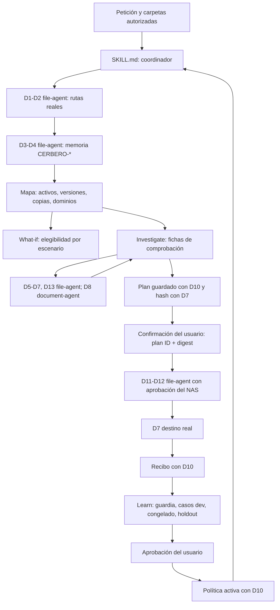
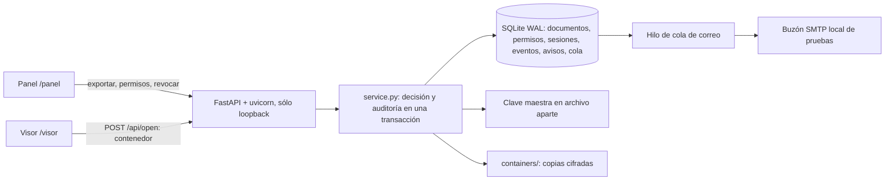

# Cerbero — diseño técnico v3 (implementación)

**Anticipar una pérdida, investigar lo necesario y recuperar con comprobaciones explícitas.**

Fecha: 10 de noviembre de 2026, actualizado el 12 de noviembre de 2026 (versión 1.2.1). Amplía [CERBERO_BLUEPRINT.md](CERBERO_BLUEPRINT.md).

Estado:

- **Skill:** el paquete `cerbero-guardian` v1.2.1 (`dist/cerbero-guardian-1.2.1.zip`) pasa el comprobador oficial del kit 0.7.3 con 0 errores y 0 advertencias. Las v1.2.0 y v1.0.0 se conservan en `dist/`; la 1.1.0 fue un borrador que nunca se empaquetó.
- **1.2.1:**
  - las entradas dependen del modo: copiar archivos elegidos no pide carpeta de proyecto;
  - un guardado cuenta sólo si el número de bytes coincide exactamente, y los registros que se vuelven a guardar conservan sus IDs;
  - si dos copias de un registro difieren, no se usa ninguna;
  - los tipos de `claim` son una enumeración;
  - todo informe empieza con una línea de resultado en lenguaje claro.

  El laboratorio aplica las mismas reglas, y las fixtures preparadas desde sesiones anteriores conservan sus vínculos de digest.
- **Revisiones:** la v1.2.0 corrige los siete defectos de [CERBERO_REVIEW_2026-11-10.md](CERBERO_REVIEW_2026-11-10.md) (R01–R07) y los cuatro de [CERBERO_REVIEW_2026-11-12.md](CERBERO_REVIEW_2026-11-12.md) (N01–N04); los reproductores pasan 7/7 y 4/4 sin modificarlos.
- **Laboratorio:** un laboratorio local ejercita las reglas de decisión contra expertos simulados, con memoria recargada sólo desde archivos guardados entre sesiones; la demo `dev/tools/run_demo.py` ejecuta cada sesión en un proceso Python distinto.
- **Evaluación de agente:** un harness permite que un modelo siga el `SKILL.md` real frente a expertos simulados; los resultados están en [submission/AGENT_EVALUATION.md](submission/AGENT_EVALUATION.md). Con la 1.2.1 empaquetada, AG04 a AG13 superan todas las comprobaciones. AG10 a AG13 forman un ciclo de aprendizaje ejecutado sólo por agentes, cada sesión sobre la memoria que dejó la anterior: revisar la regla rechazada en AG07 con casos reservados nuevos y activarla, aplicarla, retirarla y dejar de aplicarla. Es evaluación local, no UGOS.
- **Prototipo complementario (12-nov-2026):** `dev/protected_files/` añade un servicio local de exportación cifrada, acceso controlado, alertas y revocación (§15). Es independiente de la Skill: no está en el ZIP y la Skill no lo llama.
- **Pendiente:** no hay ejecución en UGOS. Lo que falta validar en el dispositivo está en [submission/NAS_VALIDATION_CHECKLIST.md](submission/NAS_VALIDATION_CHECKLIST.md).

## 1. Tesis técnica y alcance

Cerbero mantiene un modelo verificable de tres cosas:

- qué contenido espera el usuario;
- dónde existen copias;
- qué condiciones permiten recuperar un conjunto completo.

Con ese modelo explora fallos hipotéticos, escoge la siguiente observación útil, recupera con un plan aprobado y valida una mejora de defensa.

La contribución es la integración de cinco mecanismos en una Skill para NAS:

1. Memoria con procedencia, dependencias y contradicciones explícitas.
2. Mapa de recuperabilidad por versiones y dominios de fallo.
3. Investigación activa: cada consulta responde una duda que afecta una decisión.
4. Recuperación ligada a un plan aprobado y a comprobaciones previas y posteriores.
5. Aprendizaje por reproducción de casos, con contraejemplos y casos reservados.

Estos mecanismos tienen antecedentes en ingeniería de resiliencia, diagnóstico activo, contratos de software y memoria de agentes. No se afirma que cada técnica sea nueva. La originalidad defendible está en el flujo integrado y en su evaluación.

Alcance: un conjunto acotado de archivos y versiones aprobadas de un proyecto creativo. Las operaciones las realizan agentes registrados de UGOS. Quedan fuera de esta versión las cámaras, la navegación web y la restauración desde papelera.

## 2. Arquitectura implementada

Las tres cabezas son responsabilidades del flujo, no agentes nuevos:

| Cabeza | Responsabilidad | Modos de la Skill |
|---|---|---|
| Guardián | Mantiene el mapa de recuperabilidad | Baseline y What-if |
| Investigador | Selecciona comprobaciones y contrasta hipótesis | Investigate |
| Rescatista | Prepara, ejecuta y verifica recuperaciones | Recover y Learn |

El coordinador es el modelo principal de UGOS leyendo `SKILL.md`. Sólo usa trece comandos `delegate` hacia `file-agent`, `document-agent` y `knowledge-agent`. Los expertos hijos eligen la acción concreta de la CLI. El paquete Markdown no es un verificador formal ni una frontera de seguridad independiente del modelo. Los permisos y aprobaciones reales dependen de la plataforma.

### Delegaciones

| ID | Agente | Capacidad prevista | Efecto | Uso |
|---|---|---|---|---|
| D1 | file-agent | `file-workflow get-user-dir` | lectura | carpeta del usuario |
| D2 | file-agent | `ug-filesystem stat` | lectura | rutas reales y legibilidad de las carpetas nombradas |
| D3 | file-agent | `ug-filesystem ls` | lectura | archivos `CERBERO-` de la memoria |
| D4 | file-agent | `ug-filesystem cat` | lectura | texto de los registros |
| D5 | file-agent | `ug-filesystem stat` | lectura | metadatos por ruta, ausencia de destino |
| D6 | file-agent | `ug-filesystem find` | lectura | inventario y búsqueda por tamaño exacto |
| D7 | file-agent | `ug-filesystem sha256sum` | lectura | identidad, fuentes, destinos, plan y política; comparación con digests esperados |
| D8 | document-agent | `ug-document qa` | lectura | una pregunta concreta sobre un documento, tratado como dato |
| D9 | knowledge-agent | `ug-knowledge answer-official` | lectura | orientación oficial sin datos del NAS |
| D10 | knowledge-agent | `ug-knowledge save-text` | cambio, aprobación de workflow | persistir paquetes de registros |
| D11 | file-agent | `ug-filesystem mkdir` | cambio, aprobación de gateway | carpeta de recuperación y subcarpetas |
| D12 | file-agent | `ug-filesystem cpmv` en modo copia sin sobrescritura | cambio, aprobación de gateway | copia de cada entrada |
| D13 | file-agent | `ug-filesystem ls` | lectura | subcarpetas, para dividir listados posiblemente incompletos |

Los valores entre llaves (slots) sólo se llenan con resultados `completed` de la sesión o con registros cargados y comprobados; la tabla de slots de `SKILL.md` fija el origen de cada uno. Las comillas simples dentro de un valor se escapan con la secuencia que acepta el comprobador. Toda ruta enviada a un experto se declara literal, no instrucción.

## 3. Modelo de datos: identidad, versión y evidencia

El contenido se identifica por el SHA-256 que devuelve UGOS. Las rutas localizan instancias de ese contenido; una ruta no define una identidad estable. Dos rutas con el mismo hash pueden ser copias idénticas, pero no necesariamente independientes.

La memoria usa el formato `cerbero-memory-2`, documentado en `references/memory-records.md`. Cada guardado produce un paquete Markdown con varios registros, cada uno en líneas `- clave: <valor JSON>`. Las cadenas, listas y pares se escriben como JSON, de modo que apóstrofes, comas, Unicode y saltos de línea se conservan exactamente y una lista nunca se separa por comas dentro de una cadena. El lector rechaza con error explícito líneas ajenas, campos o registros duplicados, valores que no son JSON, registros incompletos y referencias a registros inexistentes. `dev/cerbero_lab/records.py` implementa escritura, lectura, validación por tipo y comprobación de referencias; una prueba compara su esquema con la tabla de la referencia.

| Registro | Campos mínimos | Función |
|---|---|---|
| scope, asset | ruta registrada, importancia, declaración | Lo que se quiere proteger |
| version | activo, sha256, tamaño, aprobación, observación | Objetivo de recuperación |
| copy | versión, ruta real, ubicación, sha256, observación, acceso, estado | Instancia candidata |
| location, domain | raíz real, pertenencias por tipo con procedencia, tipos desconocidos, padre | Dominios de fallo |
| approved-set | pares activo=versión, declaración | Evita mezclar versiones |
| statement | palabras del usuario | Declaraciones |
| case, check-card, observation | duda, decisión, operación, resultados esperables, coste, estado, cobertura | Investigación trazable |
| claim, hypothesis, open-item, finding | clase, soporte, contradicción, dependencias, estado | Interpretación separada de observación |
| map | conjunto, escenario, veredicto, niveles, incógnitas | Resultado contrafactual |
| plan, plan-entry, approval, receipt, receipt-entry | ver §6 | Contrato y recibo |
| test-case, policy, evaluation | ver §7 | Aprendizaje |

Clases de evidencia:

| Clase | Qué es |
|---|---|
| `observed` | Lo devolvió un experto. |
| `user-declared` | Lo afirmó el usuario. |
| `document-stated` | Lo dice un documento; nunca se convierte en hecho observado. |
| `official-guidance` | Proviene de la orientación oficial. |
| `inferred` | Se deduce de premisas listadas. |
| `contradicted` | Hay fuentes en conflicto. |
| `unknown` | No hay fuente. |

Dos resúmenes del mismo documento cuentan como una sola fuente. Si cambia una fuente, todas las conclusiones que dependen de ella, directa o transitivamente, pasan a `needs-review` y se recalculan. La prueba S14 lo verifica: dos afirmaciones dependientes se revisan cuando una copia registrada deja de coincidir.

## 4. Mapa de recuperabilidad

El mapa es un grafo lógico guardado en registros. Su consulta central es:

`Recuperable(conjunto, escenario)`: para toda versión requerida existe una copia elegible.

La elegibilidad tiene una sola definición, compartida por what-if y por la selección de fuentes de Recover (`mapping.copy_eligibility`). Siete condiciones: versión, hash, acceso, procedencia, estado del registro, ubicación (la ruta real dentro de la raíz de su ubicación) y escenario. Cada una puede cumplirse, fallar con evidencia negativa (la copia queda **excluida**) o carecer de evidencia (queda **incierta**). Sólo cuentan como redundancia las copias elegibles; coincidir el ID de versión nunca basta. Un grafo de dominios con ciclos, padres inexistentes, tipos repetidos o pertenencias contradictorias deja el efecto en incierto, nunca en independiente.

Escenarios:

- **Ubicación no disponible:** excluye las copias cuya ruta real está dentro de esa ubicación, incluidas las carpetas anidadas.
- **Fallo de dominio:** excluye las ubicaciones registradas como miembro del dominio, directamente o a través de un dominio hijo. Una ubicación queda fuera del fallo cuando consta en otro dominio del mismo tipo, o de un tipo ancestro (por ejemplo, otro dispositivo). Esa conclusión se registra como inferencia con sus premisas. Si la pertenencia es desconocida, la copia es incierta.

El proyecto también es una ubicación.

Nunca se deduce independencia de nombres como `backup`, de rutas distintas ni de hashes iguales. El prefijo de volumen de una ruta real se registra como observación de la ruta, no como prueba de discos separados.

Niveles de evidencia por versión:

| Nivel | Significado |
|---|---|
| `rehearsed` | Un recibo de ensayo verificó la copia. |
| `verified-now` | El hash se volvió a observar en esta sesión. |
| `modeled` | La copia viene de memoria anterior. |
| `insufficient` | Hay copias inciertas. |
| `none` | No hay ninguna copia. |

Veredictos del conjunto:

- `recoverable`: con el nivel más débil entre sus miembros.
- `not-recoverable`: sólo si el inventario de cada ubicación nombrada es completo.
- `undetermined`: en cualquier otro caso, nombrando la incógnita.

Un listado es completo sólo si se cumplen tres condiciones: devolvió menos entradas que el límite, el experto informó que no hubo truncado y no nombró subcarpetas ilegibles. Aun así, la completitud vale sólo hasta la profundidad pedida. El catálogo no garantiza esas banderas; si faltan, el listado es posiblemente incompleto.

La evaluación hipotética no borra ni desconecta nada. El ensayo copia todos los miembros a una carpeta nueva, con las mismas aprobaciones que una recuperación.

## 5. Investigación activa

Antes de cada consulta, Cerbero escribe una ficha con:

- la duda;
- la decisión que depende de ella;
- la operación;
- los resultados que cambiarían una hipótesis;
- el coste;
- el presupuesto restante.

El orden de selección es:

1. Sólo acciones de lectura dentro del alcance y de la evidencia de capacidades.
2. Primero las dudas que bloquean la recuperación de activos críticos o de miembros de conjuntos.
3. Las comprobaciones exactas (metadatos, hash, búsqueda por tamaño) antes que las interpretativas.
4. Entre comprobaciones comparables, la que discrimina más con menor coste.
5. Parar cuando la decisión está respaldada, cuando nada cambia una decisión o cuando se agota el presupuesto.

Presupuesto por defecto de la sesión: 300 hashes, 60 listados y 2 GB hasheados.

Un tamaño distinto excluye de forma exacta un hash. Un tamaño o una fecha iguales no prueban nada. Los activos críticos y los miembros de conjuntos se hashean siempre. Los ordinarios con metadatos iguales quedan como `intact-metadata`, nunca como verificados. Esta decisión de coste deja pasar la alteración de un archivo ordinario que conserva tamaño y fecha. La evaluación (S02) lo muestra, y la política POL-0001 v2 lo corrige para `raw/`.

Las causas quedan como desconocidas salvo que una fuente las afirme. Las instrucciones dentro de archivos se registran como hallazgos citados, sin acción (S09).

## 6. Recuperación con contrato y recibo

Secuencia:

1. Reconfirmar con el usuario el conjunto objetivo leído de memoria, mostrando su registro y la declaración que lo aprobó.
2. Seleccionar fuentes del mismo conjunto, prefiriendo la ubicación que cubre más miembros. Nunca se elige por fecha.
3. Re-hashear cada fuente. Si una copia registrada no coincide, se registra la contradicción y se revalidan sus dependientes.
4. Si el conjunto queda incompleto, se ofrece al usuario una recuperación parcial, otro conjunto completo o detenerse.
5. Guardar el plan con D10, junto con los registros del caso aún no guardados, hashear el archivo con D7 y obtener la confirmación de ese ID y ese digest; en la misma respuesta el usuario reconfirma el conjunto objetivo. El plan es un guardado obligatorio: si se rechaza, falla, no se verifica, no devuelve ruta, queda fuera de la carpeta de memoria o no puede hashearse, no se crea ninguna carpeta ni se copia nada.
6. Volver a hashear el plan justo antes del primer cambio. Si difiere, el plan pasa a `invalidated`.
7. Crear la carpeta (D11) y, por cada entrada:
   - re-hashear la fuente y comprobar que el destino no existe;
   - copiar (D12);
   - hashear el destino real que devuelve `cpmv`. Si `cpmv` dejó la copia en otra ruta, la entrada queda `destination-differs` y pendiente.
   - Si el destino no coincide, re-hashear la fuente para distinguir una fuente cambiada de una copia fallida.
8. Emitir el recibo con el estado de cada entrada, el estado global de las operaciones y, aparte, si el objetivo pedido quedó completo.

**Objetivo y pendientes (N01).** El objetivo se fija una vez y se escribe en el plan (`target_kind`, `target_members`): el conjunto aprobado que nombra el usuario (`approved-set`), los archivos elegidos sin referencia (`chosen-files`) o la reconstrucción completa (`full-rebuild`). Cada miembro sigue visible hasta quedar satisfecho: sin fuente (`no-source`), no comprobable (`state-unknown`) o fuera de alcance (`out-of-scope`), aparece por nombre en el plan, en el recibo y al recargar la memoria. El estado global (`overall`) es el resultado de las copias del plan; `set_complete` dice si la entrega pedida está completa. El informe dice «N copias verificadas; entrega completa» sólo cuando lo está. Un archivo cambiado fuera del conjunto pedido se informa aparte (`outside_target`), con si existe copia, y nunca se añade al plan sin una petición nueva. Así se resuelven las discrepancias de AG01 (que no amplió el objetivo) y AG03 (que no tenía dónde poner el miembro desconocido).

**Reconstrucción completa.** Sólo por petición explícita: todos los miembros del conjunto, también los intactos, en `cerbero-rebuild-<caso>`. Los intactos o movidos se copian desde el proyecto tras re-hashearlos; los demás desde una copia elegible. Después, D8 lee completo cada documento verificado como comprobación de formato. El recibo es el manifiesto: versión, procedencia y tres resultados separados (bytes iguales a la fuente leída antes de copiar, igual a la versión aprobada, formato). Un formato que ningún experto abre se informa como «no disponible», nunca como aprobado. Un digest igual no prueba ausencia de malware ni que el contenido sea el correcto.

Estados del plan: `borrador → respaldado → aprobado → en_ejecución → verified | partial | failed | cancelled | invalidated`.

Estados de entrada:

- `verified`
- `already-present-verified`
- `failed-copy`
- `failed-verification`
- `invalidated-source-changed`
- `conflict-destination-exists`
- `destination-differs`
- `no-source`
- `fidelity-only`
- `cancelled`
- `not-attempted`
- `out-of-scope`
- `state-unknown`

El reintento es una revisión nueva con confirmación nueva. Reutiliza la carpeta del recibo anterior sin enviar D11, vuelve a comprobar los destinos ya verificados y sólo copia lo pendiente (S08). Sin referencia previa se sigue el mismo protocolo de plan, aprobación y recibo; el digest esperado es el de la fuente elegida observado en la sesión y el resultado es `fidelity-only`, nunca `verified` (S13). Un rechazo del plan lo detiene todo. Sin ninguna copia, no se crea nada (S11). No se declara atomicidad ni ejecución exactamente una vez.

### Alcance de rutas

Una etiqueta de ubicación, un conjunto o una sesión anterior no autorizan una ruta. Antes de leer, crear o copiar, toda ruta se comprueba contra una raíz autorizada resuelta en la sesión (proyecto, ubicaciones de copia, memoria, carpeta padre de recuperación y carpeta nueva): forma canónica (sin `.`, `..`, componentes vacíos, barras invertidas ni caracteres de control), pertenencia por componentes y no por prefijo de texto, y rechazo de alias por mayúsculas o normalización Unicode. Una ruta tomada de memoria o de un documento se comprueba con D5 antes de que D7 la lea; si el experto no devuelve ruta real, la operación dependiente se detiene. Los destinos son la carpeta de recuperación más la ruta relativa del activo, y las rutas reales que devuelven D11 y D12 deben coincidir con las planificadas. La regla está escrita en la Skill (regla 12 y `trust-and-boundaries.md`) y en `dev/cerbero_lab/scope.py`.

## 7. Aprendizaje que debe superar contraejemplos

Estados: `candidata → evaluada → aprobada → activa → retirada`, con `rechazada` desde candidata o evaluada.

Requisitos:

- **Caso cerrado.** Sólo se aprende de un caso cerrado: su paquete y su recibo están persistidos y el usuario confirmó el resultado.
- **Casos de prueba.** Tienen que existir registros `test-case` de los cuatro tipos (origen, similar, contraejemplo e información insuficiente), con al menos uno reservado (holdout). Se guardan un split por archivo: paquetes `TD-` (desarrollo) y `TH-` (holdout). Los de desarrollo se guardan antes de redactar la regla; los reservados no se leen hasta congelarla, y el usuario puede añadirlos sólo después. Si falta alguno, la regla sigue como candidata y Cerbero pide el caso; nunca lo inventa.
- **Redacción.** La regla se redacta sólo con casos de desarrollo y lista cuáles usó.
- **Congelado.** Antes de leer el holdout, la regla se guarda con D10 (guardado obligatorio). El hash de ese archivo, calculado con D7, es `rule_sha256`. El modelo nunca escribe un digest por su cuenta. El harness de agente retiene los archivos `TH-` y sólo los coloca en la carpeta de memoria después de que el agente hashea una política candidata guardada.
- **Alcance de la medida.** El replay del laboratorio sobre casos visibles es una comprobación de consistencia del ciclo de vida, no una medida de generalización.

Guardia de invariantes. Una política nunca puede:

| Invariante | Prohibición |
|---|---|
| I1 | Añadir capacidades. |
| I2 | Ampliar el alcance o buscar en ubicaciones no nombradas. |
| I3 | Quitar o pre-responder confirmaciones o aprobaciones. |
| I4 | Permitir sobrescribir, mover o borrar. |
| I5 | Quitar la comprobación de la fuente o del destino. |
| I6 | Bajar la revisión de activos críticos o de miembros de conjuntos. |
| I7 | Tratar contenido como autoridad o atribuir causas sin fuente. |
| I8 | Ocultar cobertura, pendientes o hallazgos. |

La guardia se vuelve a aplicar a cada política activa al cargarla y antes de que cambie un resultado, porque los archivos de política viven en el mismo NAS.

**Activación en una sesión posterior.** Los efectos se escriben como líneas (`promote-critical raw`, `informational exports/previews`). Cada cambio de estado es un registro nuevo con `supersedes`: candidata congelada → activa → retirada. Una sesión nueva sólo aplica una política si son registros de confianza (listados en el índice con digest coincidente): el registro activo con la aprobación del usuario; la candidata congelada con la misma regla, cuyo archivo tiene hoy el digest `rule_sha256`; una evaluación de esa candidata con los cuatro tipos de caso, al menos uno holdout, todos aprobados; y la guardia. Las candidatas, evaluadas, rechazadas, retiradas, alteradas o sin evidencia no se activan. Quien puede escribir en la carpeta de memoria puede falsificar una cadena entera: estas comprobaciones detectan ediciones parciales y la guardia limita lo que una política falsificada puede hacer, pero no son una raíz de confianza independiente. En el laboratorio, `persistence.active_policies` decide la activación sólo desde los registros; el adaptador implementa `promote-critical` e `informational` y declara los demás efectos como no implementados.

En el laboratorio:

- **POL-0001 v1** («todo el proyecto es crítico») falla el origen y el contraejemplo, porque las vistas previas regeneradas producirían incidentes falsos.
- **POL-0001 v2** («`raw/` crítico; `exports/previews/` informativo») pasa los dos casos de desarrollo y los tres de holdout.
- **POL-0001 v3**, **POL-0002**, **POL-0003** y **POL-0004** son rechazadas por la guardia, respectivamente por I5, I7, I6 e I2.
- Sin ninguna política, el procedimiento falla los casos de origen y similares, lo que muestra para qué sirve la lección.
- En la demo multiproceso, la sesión 4 cierra el caso de la recuperación, rechaza v1 en desarrollo, congela v2, añade el holdout sólo después y la activa con la aprobación; la sesión 5, en otro proceso, la carga desde archivos y marca en riesgo los tres originales de `raw/` citando la regla congelada, la evaluación y la aprobación; tras retirarla (sesión 6), la sesión 7 ya no la aplica.

## 8. Persistencia e integridad de la memoria

Organización:

- La memoria vive en una carpeta plana elegida por el usuario. Cerbero no la crea. Una sesión nueva carga la memoria sólo desde esos archivos: lista, lee, valida, verifica contra el índice y resuelve las cadenas `supersedes` (`dev/cerbero_lab/persistence.py`). El laboratorio ejecuta cada escenario en dos sesiones: Baseline, exportación y una sesión de incidente que no recibe el objeto de memoria original (`dev/cerbero_lab/pipeline.py`).
- Todos los archivos se llaman `CERBERO-<bundle_id>`. Se buscan por nombres que contienen `CERBERO-`, por si la plataforma añade un prefijo.
- Un guardado nunca reemplaza ni añade a un archivo existente. Las correcciones se registran con `supersedes`.
- **Rutas reales (N02).** D2 da la ruta real de la carpeta de memoria. Un archivo sólo se lee (D4) o se hashea (D7) si la ruta real que devolvió D3 o D5 está dentro de ella, y la ruta real que informa la propia lectura debe ser la misma. Un enlace a otro cliente, un índice enlazado, una raíz enlazada o una respuesta sin ruta real dejan el archivo en `needs-review` sin leerlo. Las comprobaciones previas no crean atomicidad: un enlace cambiado entre dos operaciones sólo se detecta por la ruta real que informe la segunda.
- **Listados grandes.** Si D3 queda posiblemente incompleto (más de 200 archivos), se lista de nuevo por prefijos de bundle y dígitos hasta completar cada parte o agotar los 60 listados. El índice más reciente sólo se elige si todas las instantáneas se listaron completas.
- **Tamaño.** Cada guardado envía como máximo 16 KB (presupuesto de diseño por debajo de los 31,9 KB que fallaron en el harness local por el límite de línea de órdenes de Windows; el límite de `save-text` en UGOS es desconocido). Los registros nunca se parten. Si las entradas de un plan no caben, se guardan antes como fragmentos hasheados y el plan los enumera con su digest: el digest que confirma el usuario los vincula a todos. Una instantánea grande del índice se guarda en partes encadenadas por digest. Un guardado cuyo `contentBytes` no coincide con lo enviado no cuenta.

Índice:

- Las instantáneas `CERBERO-IDX-n` listan archivo y digest de cada registro vigente.
- Se usa la de número de secuencia más alto, y el índice se puede reconstruir a partir de los paquetes.
- Un archivo `CERBERO-` que no figura en el índice, o figura sin digest, queda `needs-review`. Así, un archivo plantado no cambia en silencio un conjunto, una copia o una política.
- Cada sesión abre el caso con el número siguiente al más alto encontrado en cualquier ID o nombre de archivo, incluidos los que requieren revisión, y todos sus IDs llevan ese número: un guardado parcial o un reinicio nunca reutilizan un ID.
- Un plan sin recibo se informa como inconcluso al cargar la memoria.
- **Evidencia de recuperación (N03).** Al cargar, una entrada de recibo `verified` de un plan aprobado por su digest, con fuente, destino, entrada y versión coincidentes, vuelve a enlazarse con la copia registrada que sirvió de fuente. Es evidencia histórica, en una línea aparte del mapa: no prueba que la copia siga ahí ni eleva el nivel de evidencia, y un archivo recuperado no pasa a ser copia independiente.
- Una sola instantánea de índice por sesión, al final, con el digest de cada archivo.

Límite de confianza:

- Los hashes guardados junto con los datos detectan diferencias respecto de una referencia confiable.
- No son una raíz de confianza independiente si el NAS, la memoria y las copias pueden alterarse a la vez.
- Ese escenario exige una referencia independiente y restablecer un entorno confiable. La Skill no lo automatiza.

## 9. Conocimiento externo

La única vía de entrega es `answer-official`, con preguntas generales sin datos del NAS, más las guías que el usuario guarde en una carpeta autorizada (leídas con D8). Ambas se registran como `official-guidance` o `document-stated`: son fuentes de hipótesis y nunca autorizan acciones. No hay navegación web. El catálogo no documenta si `answer-official` se ejecuta en el dispositivo o en un servicio de UGREEN.

## 10. Implementación y entorno de desarrollo

| Componente | Ubicación | Qué contiene |
|---|---|---|
| Skill | `skill/cerbero-guardian/` | `SKILL.md` (318 líneas) y 9 referencias: memoria, mapa, investigación, protocolo de recuperación, aprendizaje, confianza y límites, formatos de informe, guía de usuario, declaraciones |
| Paquetes | `dist/cerbero-guardian-1.2.1.zip` (y la 1.2.0 y la 1.0.0 conservadas) | 10 archivos Markdown idénticos a la carpeta del Skill; comprobado de nuevo tras extraerlo |
| Simulador | `dev/cerbero_lab/sim.py` | Semántica supuesta de las acciones, con inyección de fallos: permisos, truncado, fuente que cambia durante la copia, copia fallida, aprobación rechazada, guardados fallidos, no verificados, incompletos o en otra carpeta, enlaces y respuestas sin ruta real |
| Formato de memoria | `records.py`, `persistence.py`, `pipeline.py` | `cerbero-memory-2`: escritura, lectura, validación y referencias; carga sólo desde archivos; Baseline y sesión de incidente separadas |
| Alcance | `scope.py` | Forma canónica, pertenencia por componentes, alias y ruta real |
| Procedimientos | `dev/cerbero_lab/variants.py` | Variantes A, B y C (con modo Baseline), más la ablación sin selector |
| Mapa y políticas | `mapping.py`, `policy.py` | Elegibilidad única y comprobación del grafo de dominios; ciclo de vida, guardia y holdout |
| Oráculo y métricas | `oracle.py`, `metrics.py` | Verdad calculada desde los bytes; puntuación |
| Evaluador de trazas | `grader.py` | Lee la memoria exportada; separa integridad, lo que afirman los registros y los bytes de los archivos recuperados; correspondencias explícitas por ruta relativa, nombre de conjunto y referencias entre registros |
| Harness de agente | `dev/agent_eval/` | Expertos simulados que sólo aceptan las plantillas `delegate` de `SKILL.md`, usuario guionizado, traza JSONL, holdout retenido, calificador que vincula cada cambio al plan exacto aprobado (N04), procedencia por hash del Skill, referencias, caso, fixture y evaluador |
| Demo multiproceso | `dev/tools/run_demo.py` | Ocho pasos sobre S00V, cada sesión en su propio proceso, con el NAS simulado en disco |
| Fixtures | `dev/fixtures/` | 2 bases, 15 escenarios, 5 casos de política (2 de desarrollo y 3 de holdout), 6 políticas candidatas y el escenario de demo S00V con PDF, DOCX y TIFF válidos |
| Pruebas | `dev/tests/` | 151 pruebas, más las reproducciones de `dev/review/reproduce_review.py` (7) y `reproduce_review_2026_11_12.py` (4) |
| Herramientas | `dev/tools/` | Descarga verificada del kit, comprobador oficial, ZIP versionado, evaluación, datos de demo y PDF de la propuesta |

El laboratorio es un oráculo independiente fuera del paquete. No sustituye operaciones del NAS en la demo ni se distribuye con la Skill.

## 11. Evaluación

Se comparan tres variantes con los mismos fixtures, límites de listado, fallos, aprobaciones y verificaciones esenciales:

- **A:** flujo simple sin memoria persistida (nombres y fechas, copia más reciente, verificación de fidelidad).
- **B:** memoria de referencia con hashes y conjuntos aprobados.
- **C:** arquitectura completa.

También se incluye C sin selector. Los resultados completos están en [submission/EVALUATION_REPORT.md](submission/EVALUATION_REPORT.md).

Cada variante ejecuta los 15 escenarios con estado propio. B y C cargan la memoria sólo desde los archivos guardados por una sesión Baseline; una prueba ejecuta las variantes en dos órdenes y exige resultados y contadores idénticos. Cifras de la evaluación regenerada en la v1.2.0 y comprobadas de nuevo en la v1.2.1 (idénticas salvo los tiempos locales):

| Métrica (15 escenarios) | A | B | C | C sin selector |
|---|---|---|---|---|
| Estados de activos correctos | 51/64 | 63/64 | 63/64 | 63/64 |
| Archivos movidos localizados | 0/4 | 3/4 | 4/4 | 3/4 |
| Veredictos what-if correctos | 1/4 | 1/4 | 4/4 | 4/4 |
| Copias contadas de más como redundancia | 10 | 10 | 0 | 0 |
| Recuperaciones requeridas verificadas con la versión correcta | 6/14 | 13/14 | 14/14 | 14/14 |
| Recuperaciones afirmadas con versión incorrecta | 6 | 0 | 0 | 0 |
| Límites reconocidos | 0/4 | 0/4 | 4/4 | 4/4 |
| Estado global del recibo correcto | 7/13 | 11/13 | 13/13 | 13/13 |
| Completitud del objetivo informada correctamente | 0/12 | 0/12 | 12/12 | 12/12 |
| Cambios fuera del objetivo informados aparte | 0/2 | 0/2 | 1/2 | 2/2 |
| Llamadas a expertos | 124 | 454 | 608 | 711 |
| Bytes hasheados | 444 464 | 5 099 994 | 2 627 648 | 4 718 729 |
| Aprobaciones solicitadas | 25 | 31 | 80 | 93 |
| Guardados de memoria | 0 | 0 | 53 | 65 |

Cambios que no se ocultan. En la v1.2.0 el estado global es el resultado de las copias y la completitud es un campo aparte; las expectativas de S00, S02 y S04 cambiaron con esa definición (antes contaban un archivo fuera de «Entrega 2» o un miembro sin fuente dentro del estado global), y A y B, que no tienen noción de objetivo, puntúan 0 en las dos métricas nuevas por construcción. Los guardados y aprobaciones de C suben (de 43 a 53 y de 70 a 80) porque los registros se agrupan en guardados de 16 KB como máximo. Respecto de la v1.0.0: C sin selector incluye S13; S13 exige `fidelity-only`; B y C cargan la memoria desde archivos.

Lectura honesta de los resultados:

- **Coste.** C hace más llamadas que B en 10 de 12 escenarios de incidente y pide más aprobaciones, sobre todo por los 53 guardados de memoria. Hashea menos bytes.
- **Error propio.** C falla una alteración de un archivo ordinario (S02) y por eso tampoco puede informarla fuera del objetivo.
- **Límites de B.** B falla en S05, S06, S14 y S15: dominios compartidos o desconocidos, copias registradas obsoletas y listados truncados.
- **Alcance de la comparación.** Es contra las líneas base implementadas aquí, no contra otros asistentes o productos.
- **Qué no se mide.** Los tiempos son de ejecución local, no latencia del NAS. No hay datos de tokens. Ninguno de estos resultados demuestra comportamiento en UGOS.

## 12. Demostración

El guion está en [submission/DEMO_SCRIPT.md](submission/DEMO_SCRIPT.md) y dura 2:56: incidente, recuperación con «entrega completa», reconstrucción completa, aprendizaje y una sesión nueva que explica qué aplica y por qué. Es un plan de grabación: todavía no existe vídeo. Usa el conjunto sintético del escenario S00V generado por `dev/tools/make_demo_dataset.py`, en el que `brief.pdf`, `copy.docx` y `cover.tif` son archivos válidos que se abren tras recuperarlos, y declaraciones veraces para el NAS de pruebas.

Si el dispositivo tiene un solo volumen:

- perder la carpeta del proyecto es recuperable desde la copia de octubre;
- un fallo del volumen 1 no es recuperable, porque todas las copias comparten volumen.

Los cortes se rotulan. El vídeo debe mostrar la ejecución real en el NAS asignado. La misma historia se ejecuta en el laboratorio con `python dev/tools/run_demo.py all`; su salida está en el informe de evaluación y no sustituye la grabación. La memoria exportada y una copia de la carpeta de recuperación se evalúan después con el evaluador de trazas (`--files`).

## 13. Decisiones de adaptación al kit y a las reglas

1. **Sin `README.md` dentro del paquete.** La raíz del paquete sólo admite `SKILL.md` y `references/`, porque el comprobador da error con cualquier otro elemento, aunque la página del kit recomiende un `README.md`. La guía para el usuario va en `references/user-guide.md`; el README del repositorio queda fuera del ZIP.
2. **Encabezados del comprobador, no de la plantilla.** Se usan `# Orchestration` y `# Generation-time capability evidence` con el formato `` - `cli` → `agent` ``. La plantilla del kit (`# Expert orchestration`, `- <cli> -> <agent>`) no satisface al comprobador.
3. **Slots con llaves.** Se usan `{slot}` en lugar de `<slot>`, que el comprobador marca como sin resolver. Cada slot tiene un origen declarado. El comprobador no puede verificar la sustitución real, que queda pendiente de validar en el dispositivo.
4. **Todo en inglés.** La Skill y los materiales de entrega están en inglés porque las reglas lo exigen. Los documentos de diseño siguen en español.
5. **Capacidades excluidas.** Se excluyen `ug-filesystem restore` (semántica de rutas y efecto no validados), `ug-surveillance` (fuera del recorrido principal) y `ug-filemgr` (no es necesario).
6. **Memoria con `save-text`.** Se usa `save-text` en una carpeta plana, nunca `echo`, que admite sobrescritura. Cada guardado agrupa los registros de un punto de control para reducir aprobaciones.
7. **Línea base con un listado por ubicación.** Un listado por ubicación, seguido de hashes sólo de los tamaños coincidentes, sustituyó a una búsqueda por cada tamaño: misma exactitud con menos llamadas. Lo detectó la medición del coste de memoria.
8. **Hallazgos de la revisión adversarial aplicados.** La revisión independiente de la Skill dio lugar a estos cambios:
   - la memoria es evidencia y no autoridad: reconfirmación del conjunto y guardia al cargar;
   - completitud conservadora y la delegación D13;
   - escapado de comillas;
   - `destination-differs`;
   - re-hash del plan;
   - reintento que reutiliza la carpeta y ensayo con todos los miembros;
   - congelado de la regla mediante D10 y D7;
   - presupuesto de sesión;
   - invariante I8.
9. **Segunda revisión (R01–R07) aplicada en la v1.1.0:**
   - el plan es un guardado obligatorio y bloquea carpeta y copias si no se persiste, verifica y hashea;
   - un único protocolo de plan, aprobación y recibo también sin referencia, con resultado `fidelity-only`;
   - regla 12 de alcance de rutas en la Skill y en el laboratorio;
   - formato `cerbero-memory-2` reversible, con validación y referencias;
   - una sola definición de elegibilidad y comprobación del grafo de dominios;
   - persistencia probada entre sesiones, IDs por número de caso y grader con correspondencias explícitas;
   - variantes aisladas y denominadores comunes;
   - confirmación del conjunto junto con el plan y registros del caso guardados con el plan, para reducir confirmaciones opcionales sin quitar ninguna aprobación oficial;
   - holdout ciego: archivos `TH-` leídos sólo después de congelar la regla.
10. **Reglas oficiales sin acceso directo.** La página oficial de reglas devolvió HTTP 403 al acceso automatizado. Las preguntas de la propuesta y los límites se tomaron de una copia textual pública (`github.com/bgrubbs1/ugreen-story-reel`, `research/rules.txt`) y deben confirmarse en Devpost.

## 14. Fuentes e inspiración

- [UGREEN Hackathon: reglas](https://ugreenhackathon.devpost.com/rules), [página del hackathon](https://ai.ugreen.com/pages/ugreen-hackathon) y [Starter Kit](https://ai.ugreen.com/pages/hackathon-starter-kit). Kit 0.7.3, catálogo 2.0.0, SHA-256 del archivo `cf557e5a…e1b3`.
- [NIST SP 800-160 Vol. 2 Rev. 1](https://csrc.nist.gov/pubs/sp/800/160/v2/r1/final). Marco de resiliencia; no certifica ni valida Cerbero.
- [Agentic Context Engineering](https://arxiv.org/abs/2510.04618) y [The components of agent memory, Anthropic](https://www.anthropic.com/research/components-of-agent-memory). Antecedentes de memoria revisada contra la experiencia; sus resultados no se atribuyen a Cerbero.

## 15. Prototipo complementario: archivos protegidos

Servicio local de desarrollo en `dev/protected_files/` (paquete `cerbero_pf`), añadido el 12 de noviembre de 2026. La Skill sigue siendo de orquestación pura.

**Separación respecto de la Skill:**

- El prototipo no entra en el ZIP, no añade comandos UGOS, no cambia las reglas de recuperación ni de aprobación de `SKILL.md`, y la Skill no lo consume automáticamente.
- La relación es documental: el panel exporta, por documento, un registro JSON (`cerbero-pf-audit-1`) para revisarlo a mano junto a un caso.
- Integrarlo en UGOS exigiría capacidades del catálogo que hoy no existen.

### 15.1 Alcance

- La persona propietaria exporta un archivo elegido a un contenedor `.cerbero` cifrado. El original no se modifica.
- Sólo se protegen las exportaciones de este flujo; no se interceptan otras copias.
- Quien recibe el contenedor lo carga en el visor web del mismo servicio, que avisa del registro y pide sesión.
- El servidor descifra después de comprobar cuenta, permiso, integridad y estado.
- Marcar extraviado o revocar deniega toda solicitud nueva. Los intentos sospechosos dejan evento, aviso en el panel y correo opcional.

### 15.2 Arquitectura

| Módulo | Responsabilidad |
|---|---|
| `crypto.py` | Contenedor v1, AES-256-GCM (`cryptography`), clave maestra, envoltura y comprobación de clave |
| `service.py` | Cuentas, sesiones, exportación, permisos, estados, apertura, eventos, avisos, cola de correo |
| `web.py` | Rutas, CSRF, `Origin`, `TrustedHost`, CSP y cabeceras, límites de carga, códigos de estado del visor |
| `geo.py` | IP de la conexión, proxies confiables, proveedor `none`/`csv`/`simulated`, ubicación declarada por el navegador |
| `mail.py` | Adaptador SMTP y buzón local (aiosmtpd) |
| `security.py` | scrypt, saneamiento de nombres y textos, clasificación de formatos |
| `demo.py` | Demo de seis pasos con servidor en otro proceso y reinicio |

### 15.3 Contenedor y claves

- **Estructura:** `CERBERO` + versión + longitud de cabecera + cabecera JSON canónica (`alg`, `created`, `doc`, `len`, `nonce`, `v`) + texto cifrado con etiqueta.
- **AAD:** todo el prefijo. Una clave aleatoria de 256 bits por exportación, con nonce de 96 bits; cada clave cifra un único mensaje.
- **Dónde vive la clave:** la clave del documento sólo existe en el servidor, envuelta con AES-256-GCM bajo la clave maestra y con el ID como AAD.
- **Clave maestra:** está en un archivo aparte, fuera del directorio de datos y del público.
  - Una comprobación cifrada en la base detecta una clave ausente o distinta, y el servicio se niega a arrancar.
  - `genkey` nunca sobrescribe, y nada genera claves en silencio.
- **Vínculo del contenedor con el documento:** se exige el SHA-256 del contenedor completo registrado al exportar y, después, la etiqueta GCM.
- **Contenedores que no coinciden:** un ID inventado o un contenedor que no coincide queda como telemetría no verificada, sin avisos ni incidente atribuido.
- **Límite de tamaño:** 1 MiB por archivo (configurable hasta 8 MiB).
- **Formatos del visor:** muestra texto UTF-8 e imágenes raster. HTML, SVG, scripts y macros nunca se entregan.

### 15.4 Autorización, revocación y auditoría

- **Comprobación en cada solicitud:** cada endpoint sensible comprueba la sesión, y las acciones de cambio comprueban también el token CSRF y `Origin`. Para un tercero, los recursos ajenos devuelven 404.
- **Apertura en una sola transacción:** `POST /api/open` abre una transacción `BEGIN IMMEDIATE` que lee el estado y el permiso, descifra en memoria y escribe el evento. El contenido se devuelve sólo después del `COMMIT`. Si el evento no se puede escribir, la respuesta es 503 y no se entrega nada.
- **Momento efectivo:** una revocación es efectiva en el `COMMIT` de su transacción, y ese instante se devuelve como `effective_at`. Como SQLite serializa las escrituras, el orden de `events.id` es el orden de confirmación. La prueba de concurrencia exige que ninguna entrega tenga un ID posterior al de la revocación.
- **Lo que queda fuera:** las solicitudes confirmadas antes de ese instante quedaron autorizadas, y lo ya entregado no se retira.
- **Persistencia:** WAL con `synchronous = FULL`. Persisten documentos, permisos, sesiones, revocaciones, eventos, avisos, intentos fallidos de inicio de sesión y cola de correo.

### 15.5 Ubicación y alertas

- **IP:** se usa la de la conexión. `X-Forwarded-For` sólo cuenta desde proxies configurados; uvicorn se arranca con `proxy_headers=False`.
- **Ubicación por IP:** es opcional y sólo con base local (CSV). Una IP privada o de loopback, la falta de proveedor o la falta de resultado dan «no disponible», sin coordenadas inventadas.
- **Proveedor simulado:** existe sólo para la demo y marca cada resultado como «SIMULADO».
- **Ubicación del navegador:** se pide tras una acción explícita y un aviso, y se guarda como declarada por el cliente, con su procedencia, la hora informada, la hora de recepción y la precisión. Denegarla no cambia el acceso.
- **Avisos:** se agrupan con su recuento dentro de una ventana de 15 minutos, con un tope de correos por hora.
- **Cola de correo:** persistente, con estados pendiente, enviado y fallido, y reintentos limitados. «Enviado» sólo se marca tras la aceptación SMTP.
- **Contenido del correo:** no adjunta contenido, claves, IP ni coordenadas.
- **SMTP externo:** desactivado salvo `allow_external = true`.

### 15.6 Verificación (12-nov-2026)

| Comprobación | Resultado | Evidencia |
|---|---|---|
| Pruebas del prototipo (`dev/protected_files/tests`) | 75: 74 correctas y 1 omitida (enlace simbólico de archivo: `WinError 1314`, sin privilegios). La contención se cubre con una *junction* de directorio | `dev/review/logs/after-2026-11-12-protected-files-tests.txt` |
| Revisión adversarial independiente (subagente) | Ningún camino entrega contenido sin auditoría, tras una revocación, sin permiso o con un contenedor alterado. Hubo 10 hallazgos medios o bajos, corregidos o mitigados con regresiones: límites eludibles por concurrencia, cuerpos JSON sin tope antes de autenticar, bloqueo de la cuenta propietaria (orden local `set-state`), desbordamiento en la ubicación, `Origin` detrás de un proxy, QUIT tras DATA y `$` en las expresiones regulares. Quedan dos riesgos residuales: la carrera en la exportación por ruta y la cookie plantada desde otro puerto local | `ReviewRegressions` en `tests/` |
| Demo de seis pasos, servidor real y reinicio abrupto | 15/15 (16/16 con el caso SIMULADO) | `dev/out/protected_files_demo/demo-transcript.txt` |
| Navegador (Chromium con Playwright): visor y panel en contextos separados, sin errores de consola ni violaciones de CSP | correcta | `test_e2e.BrowserFlow` |
| Suite de la Skill | 147/147 con la Skill 1.2.0 al cerrar el prototipo; 151/151 tras la 1.2.1 | `dev/review/logs/after-2026-11-12-protected-unittest.txt`, `dev/review/logs/after-2026-11-12-1.2.1-unittest.txt` |
| Reproducciones de revisión | 7/7 y 4/4 | `dev/review/logs/after-2026-11-12-protected-reproduce_review*.txt` |
| Comprobador oficial del kit | 0 errores, 0 advertencias | `dev/review/logs/after-2026-11-12-protected-check_skill.txt` |

### 15.7 Límites

- No hay rastreo fuera del visor ni detección de descifrado fuera de línea.
- Sin conexión no hay apertura nueva ni alerta.
- La ubicación no demuestra identidad.
- Revocar no borra lo ya entregado, y no se impiden capturas.
- No protege frente al compromiso completo del servidor.
- Perder el servicio, su base o su clave maestra puede impedir recuperar estas exportaciones; no hay rotación ni depósito de claves.
- Integración con UGOS y validación en el NAS: pendientes.
